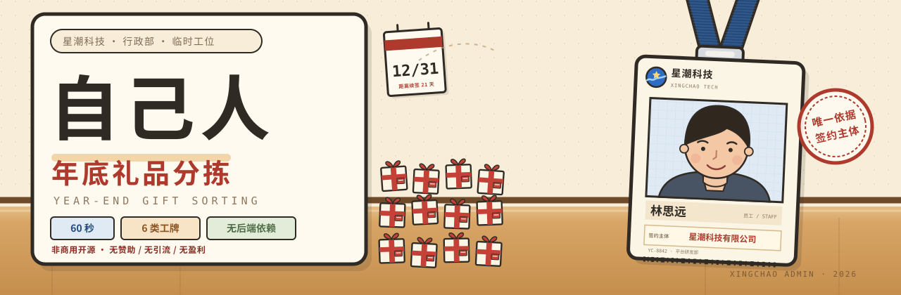
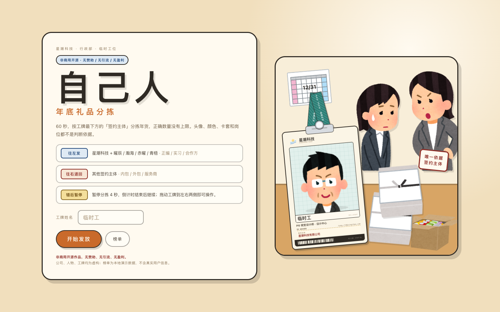
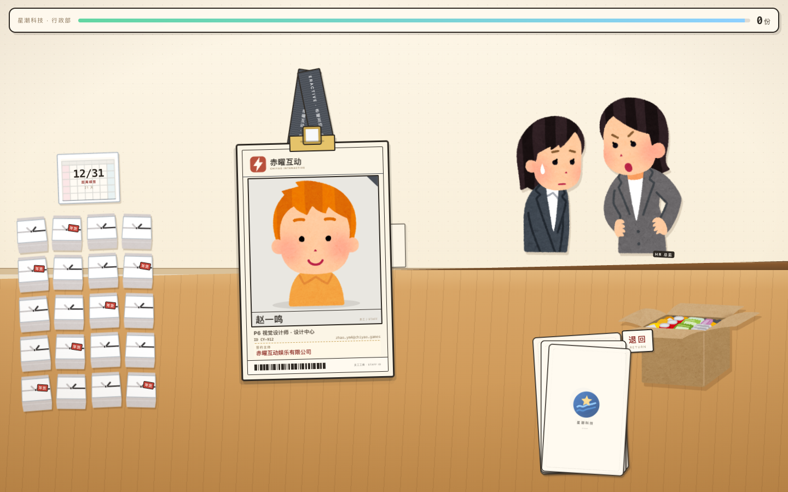
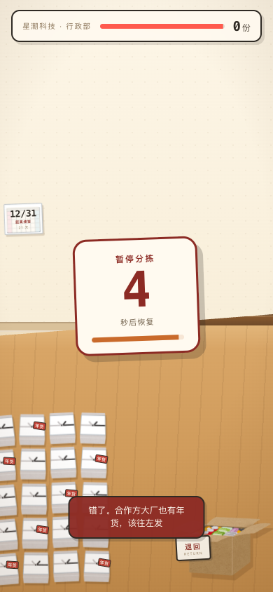

<p align="center">
  
</p>

<h1 align="center">自己人 · 年底礼品分拣</h1>

<!-- 游戏入口与核心特色（醒目大字） -->
<p align="center">
  <a href="https://conflux-336.github.io/ziji-ren/"></a>
  
  
</p>

<!-- 技术栈与非商用声明 -->
<p align="center">
  
  
  
  
  
  
</p>

<!-- GitHub 仓库状态（小巧不抢眼） -->
<p align="center">
  
  
  
</p>

<p align="center">
  <a href="https://conflux-336.github.io/ziji-ren/"><b>在线游玩</b></a> ·
  <a href="#-玩法规则">玩法规则</a> ·
  <a href="#-本地运行">本地运行</a> ·
  <a href="#-素材与授权">素材与授权</a>
</p>

<p align="center">
  你是一名年底行政。头像、配色、卡套和岗位都可能骗人——<br>
  唯一可靠的线索，是工牌最下面那行 <b>「签约主体」</b>。
</p>

<p align="center">
  
  
</p>

<p align="center"><sub>开始页集中讲清规则；进入对局后不再持续提示。</sub></p>

<details>
<summary><b>📱 移动端预览（390 × 844）</b></summary>

<p align="center">
  
</p>

</details>

## ✨ 特性速览

- 🪪 **六类工牌，一条规则** — 正编、实习生、合作方往左发；内包、外包、服务商往右退回。判断只看签约主体。
- 🌐 **简中 / English / 日本語** — 右上角一键切换，界面、工牌、结算、榜单与 Canvas 海报全部跟随；首次访问按浏览器语言自动检测，选择持久化在本地。
- 🎭 **故意让人看走眼** — 工牌不印身份标签；五种织带配色在六类工牌间随机；姓名、岗位、邮箱和头像也不参与判定。
- 🏢 **合作方大厂也有年货** — 曜辰、瀚海、赤曜、青梧四家虚构合作方，与星潮科技一样往左发。
- ⏱️ **60 秒，没有上限** — 正确分拣越多越好，不设固定工牌数量，也没有礼盒库存上限。
- ⏸️ **错一次，停四秒** — 错误不扣分，但 HR 会当场变脸，画面暂停分拣并显示 4 秒倒计时。
- ⌨️ **电脑端键盘可玩** — 桌面端按 <kbd>←</kbd> 往左发、<kbd>→</kbd> 往右退回，与拖拽完全等价；输入框打字时不会误触发。
- 🎨 **完整 2D 插画舞台** — 办公室、礼盒、纸箱、台历与 HR 全部由本地 Irasutoya 素材和 CSS 分层组成。
- 🔒 **本地优先** — 无后端、无账号、无统计脚本；运行时零外部请求，成绩和榜单只存在浏览器 `localStorage`。
- 🖼️ **结算海报** — 使用 Canvas 现场绘制成绩工牌与海报，可在本机保存分享。
- 🍒 **藏了一个结局** — 开始按钮似乎还能往右拖一点……

---

## 🎯 玩法规则

| 方向 | 工牌类型 | 签约主体 |
| :---: | --- | --- |
| **← 往左发** | 正编 / 实习生 | 星潮科技有限公司 |
| **← 往左发** | 合作方大厂 | 曜辰互动、瀚海云科、赤曜互动、青梧数科 |
| **往右退回 →** | 内包 | 星潮云服（杭州）有限公司 |
| **往右退回 →** | 外包 | 蓝海人力资源服务有限公司 |
| **往右退回 →** | 服务商 | 智云企业服务有限公司 |

> [!IMPORTANT]
> 工牌上不会直接写着“正编”“外包”“合作方”。不要根据头像、配色、卡套或岗位猜——把视线放到最下方的**签约主体**。

### 计分与操作

| 规则 | 说明 |
|---|---|
| 对局时长 | 60 秒 |
| 正确分拣 | 每份 +1，正确数量无上限 |
| 错误分拣 | 本次不计分，暂停分拣 4 秒 |
| 操作方式 | 按住工牌向左或向右拖动，松手发放；电脑端可按 <kbd>←</kbd> / <kbd>→</kbd> 方向键分拣 |
| 教学 | 首次进入依次出现六张示例工牌，覆盖全部类型 |
| 结算 | 显示正确数、错发数、误退数与本机最好成绩 |
| 榜单 | 本地演示榜单，不采集真实用户信息 |

<h3 align="center">别被这些线索带走</h3>

| 线索 | 是否可靠 | 原因 |
| :---: | :---: | --- |
| 头像 | ❌ | 普通工牌共用头像池，合作方另有二次元头像池；外观不决定是否“自己人” |
| 织带配色 | ❌ | navy、蓝黄、teal、orange、grey 五种配色在六类工牌间随机出现 |
| 卡套与夹子 | ❌ | 六类工牌共用同一套插画卡套，没有等级差异 |
| 姓名 / 岗位 / 工号 | ❌ | 随机生成，与签约主体没有绑定关系 |
| 品牌区 | ⚠️ | 能看出公司，但合作方同样是“有年货的自己人” |
| **签约主体** | ✅ | **唯一可靠的判断依据** |

---

## 🛠 本地运行

这是一个**没有构建步骤**的静态网页。克隆后启动任意静态文件服务器即可：

```bash
git clone https://github.com/Conflux-336/ziji-ren.git
cd ziji-ren
python3 -m http.server 8137
```

然后打开：

```text
http://localhost:8137/
```

不需要 `npm install`，不需要环境变量，也不需要配置 API。

> 也可以直接打开 `index.html`，但推荐通过本地 HTTP 服务访问，避免个别浏览器对本地文件的安全限制。

---

## 🧱 项目结构

```text
ziji-ren/
├── index.html                  # 单页游戏：DOM 舞台、工牌逻辑、海报、榜单
├── i18n.js                     # 三语字典、模板插值与语言检测（无依赖 IIFE）
├── assets/irasutoya/           # 35 件本地插画素材、manifest 与 CREDITS
├── vendor/qrcode.min.js        # 本地二维码生成库
├── tools/
│   ├── fetch-irasutoya.mjs     # 下载并校验基础素材
│   ├── fetch-anime-assets.mjs  # 合作方头像与独立素材批次
│   ├── verify-game.mjs         # 无头 Chrome 端到端回归
│   └── verify-i18n.mjs         # 三语字典结构、切换与持久化专项回归
├── docs/                       # README 横幅与截图
└── .gitignore
```

### 技术实现

| 层 | 实现 |
|---|---|
| 页面与舞台 | 原生 HTML / CSS，DOM 分层 2D 插画场景 |
| 国际化 | 独立 `i18n.js` 字典 + `data-i18n` 静态绑定，无 i18n 库、无构建 |
| 游戏逻辑 | 原生 JavaScript，seeded RNG 生成姓名、岗位、配色与头像 |
| 工牌 | CSS 绘制卡套、织带、条码与信息层级 |
| 海报 | Canvas 2D 绘制，配合本地 `qrcode.min.js` |
| 数据持久化 | `localStorage` 保存最好成绩、榜单与隐藏结局计数 |
| 部署 | GitHub Pages |
| 运行时外部请求 | **0** |

### 调试接口

浏览器控制台内置 `window.__ZJ`，便于检查规则与版式：

```js
__ZJ.sheet();                 // 并排查看六类工牌
__ZJ.begin({ drill: true });  // 进入六步教学
__ZJ.demo('pt');              // 强制生成一张合作方工牌
__ZJ.commit(-1);              // 模拟往左发放
__ZJ.setLang('ja');           // 切换语言（zh / en / ja）
```

运行完整回归前，需要先启动 `http://localhost:8137/`，并让本机 Chrome 开放 CDP `9222` 端口：

```bash
node tools/verify-game.mjs     # 玩法端到端回归
node tools/verify-i18n.mjs     # 三语专项回归
```

---

## 🎨 素材与授权

本作插画来自 **[いらすとや（Irasutoya）](https://www.irasutoya.com/)**，共 **35 件不同素材**，全部下载到本地 `assets/irasutoya/`，游戏运行时不热链、不请求第三方图片。

- “非商用”不构成授权，也不代表 いらすとや 参与制作或为本作背书。
- 素材只作为游戏组成部分使用，不作为素材包再分发或售卖。
- 游戏中的公司、人物、工牌、榜单均为虚构或本地演示数据。

完整素材名、来源页与用途见 **[assets/irasutoya/CREDITS.md](assets/irasutoya/CREDITS.md)**。

---

## 📌 项目声明

- 本项目为**非商用开源作品，无赞助、无引流、无盈利**。
- 不接入广告、付费、统计或第三方账号；对局数据不离开本机。
- 仓库尚未单独附带 `LICENSE`；复用代码或素材前，请先联系作者确认授权。
- 游戏内公司与品牌均为虚构，不指向任何真实企业。

<p align="center">
  <a href="https://conflux-336.github.io/ziji-ren/"><b>开始分拣 →</b></a>
  <br><br>
  <sub>插画素材：いらすとや · 非官方合作 · 代码与文案由 Conflux-336 制作</sub>
</p>
